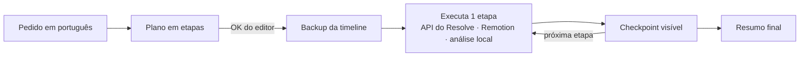

# ResolveAgent — agente de IA que edita vídeos dentro do DaVinci Resolve

> Agente criado no Claude Code que opera o **DaVinci Resolve Studio pela API Python**. O editor pede em linguagem natural ("monta um reel de 30 s no beat, com legenda e nome em lower third") e o agente planeja, executa e mostra cada etapa para aprovação.

**👤 Autor:** Ricardo Gasparelo · [Portfólio](https://githubiogithubio.vercel.app) · [LinkedIn](https://www.linkedin.com/in/ricardo-gasparelo-212381380/)

---

## O problema

Editores gastam a maior parte do tempo em tarefas repetitivas na timeline: tirar silêncios, cortar no beat, legendar, organizar B-roll, montar lower thirds. Ferramentas de IA "mágicas" costumam tirar o controle do editor e quebrar o projeto.

## O que eu construí

Um agente que trabalha **como um assistente de edição**, dentro do programa que o editor já usa:

| Comando | O que faz |
|---|---|
| `/editar` | entende o pedido, escreve um plano em etapas e espera o OK |
| `/cortar` | corta no beat da música e remove silêncios da fala |
| `/legendas` | transcreve em pt-BR (Whisper) e gera legenda nativa no Resolve |
| `/broll` · `/organizar` | cataloga B-roll e organiza a mídia |
| `/match-cut` | sugere e monta match cuts entre planos |
| `/texto-animado` · `/efeito` | texto cinético, lower thirds e efeitos em Remotion (overlays com transparência) |
| `/transicoes` · `/mascaras` · `/estabilizar` | transições, máscaras e estabilização |
| `/exportar` | exporta para Reels e YouTube |
| `/aprender-estilo` | lê projetos antigos e monta o perfil de corte do editor |
| `/status` | conta em que pé está o trabalho |

**14 skills**, **22 receitas** de efeitos tiradas do estudo de **45 referências**, kit de motion próprio (Liquid Glass Graph, Screen Push, Over the Shoulder, Kinetic Text, Lower Third, Transition A/B) e instalação documentada com guia de primeiro uso.

## Como eu projetei o comportamento do agente

Escrevi o "cérebro" do agente (`CLAUDE.md`) como uma **especificação**, não como um pedido:

- **Protocolo de execução:** entender → plano em etapas → OK do editor → backup da timeline → uma etapa por vez → checkpoint visível (still ou trecho de 5–10 s) → fechar com resumo.
- **Regras de parada:** 2 tentativas por abordagem, 3 renders por etapa, 15 minutos por etapa. Passou disso, para e reporta.
- **Nativo antes de gambiarra:** se o Resolve faz em 1 clique (Stabilize, Smart Reframe), o agente pede para o editor clicar em vez de reconstruir em código.
- **Nada se perde:** duplica a timeline antes de mexer (`<nome>__antes_HHMM`) e nunca toca nos originais.
- **Tudo local:** transcrição, beats, cenas e rostos analisados no próprio Mac; nada sai da máquina.

## Tecnologias

`Claude Code (agente + skills)` `Python` `DaVinci Resolve Scripting API` `Whisper` `análise de beats, silêncios, cenas e rostos` `Remotion (React)` `TypeScript` `FFmpeg` `Shell (instalador sem sudo)`

## Resultado

Em uso por mim e pelos consultores de marketing da JR Consultoria (UFPR), com versão de instalação para colegas.

---

### Sobre o código

Este repositório é a **vitrine** do projeto. O código-fonte completo é privado. Para uma demonstração ou acesso ao código, fale comigo no [LinkedIn](https://www.linkedin.com/in/ricardo-gasparelo-212381380/).

© 2026 Ricardo Friedrich Gasparelo. Todos os direitos reservados. Veja [LICENSE](LICENSE).
